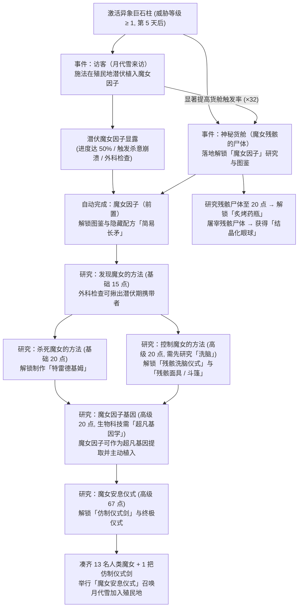

# 《魔女因子扩散中——魔法少女的魔女审判拓展》玩法说明

> **适用版本**：RimWorld 1.6（模组版本 v1.0.11）  
> **前置要求**：必需《皇权（Royalty）》《异象（Anomaly）》DLC 与前置模组 Harmony；搭配《生物科技（Biotech）》DLC 可解锁「魔女因子基因」完整玩法，搭配《文化（Ideology）》《奥德赛（Odyssey）》亦有专属联动效果。

本模组围绕**「魔女因子」**展开，为边缘世界加入了一套由心情驱动的异象转化体系、一种全新的可控异象变种人**「魔女的残骸」**，以及幕后推手大魔女**「月代雪」**的系列事件与招募路线。

---

## 目录

- [一、模组整体进度路线](#一模组整体进度路线)
- [二、核心内容 1：魔女因子——一般殖民者的演化机制](#二核心内容-1魔女因子一般殖民者的演化机制)
- [三、核心内容 2：魔女残骸——异象变种人种族](#三核心内容-2魔女残骸异象变种人种族)
- [四、核心内容 3：月代雪及相关事件](#四核心内容-3月代雪及相关事件)
- [五、隐藏配方与模组设置速查](#五隐藏配方与模组设置速查)

---

## 一、模组整体进度路线

模组的全部核心内容均归属**异象（Anomaly）**体系，推进前提是**殖民地至少达到第 5 天、地图上有自由殖民者，且已激活异象巨石柱（异象威胁等级 ≥ 1）**。

### 异象研究树总览

所有研究均位于「异象」研究分页：

| 研究项目 | 知识类型与点数 | 解锁与显现条件 | 核心解锁内容 |
| :--- | :--- | :--- | :--- |
| **魔女因子** | 基础（自动完成） | 任意携带者魔女因子显露，或「神秘货舱」残骸尸体落地时自动完成 | 解锁「魔女因子」异象图鉴、隐藏配方「简易长矛」，并显现下一项研究 |
| **发现魔女的方法** | 基础 · 15 点 | 完成「魔女因子」 | 强化「外科检查」手术，可提前查出处于潜伏期的魔女因子携带者 |
| **杀死魔女的方法** | 基础 · 20 点 | 前置「发现魔女的方法」 | 解锁在药物实验台制作致死药剂**「特雷德基姆」** |
| **控制魔女的方法** | 高级 · 20 点 | 前置「发现魔女的方法」+ 原版异象研究「洗脑」 | 解锁**「残骸洗脑仪式」**及活铁装备**「残骸面具」「残骸斗篷」** |
| **魔女因子基因** | 高级 · 20 点 | 前置「杀死魔女的方法」+「控制魔女的方法」；启用《生物科技》时另需「超凡基因学」（完成前两者之一后显现） | （生物科技）已显露的携带者与残骸变种人显现**「魔女因子」超凡基因**，可提取并批量植入 |
| **魔女安息仪式** | 高级 · 67 点 | 前置「魔女因子基因」 | 解锁制作**「仿制仪式剑」**与终极仪式**「魔女安息仪式」** |

> **实用小贴士**：通过异象的「挑衅虚空」仪式也有机会主动引来「神秘货舱（魔女残骸的尸体）」，加速前期科技起步。

---

## 二、核心内容 1：魔女因子——一般殖民者的演化机制

「魔女因子」是一种从心灵层面侵蚀人类的外来异象。它会潜伏在殖民者体内，随心情起伏不断加深或缓和，最终将宿主推向截然不同的命运终点。

### 1. 殖民者如何获得魔女因子

| 获取途径 | 触发说明 | 初始是否显露 |
| :--- | :--- | :--- |
| **月代雪来访施法** | 访客「月代雪」在殖民地完成施法后，秘密感染地图上 1 名合规自由殖民者 | 否（潜伏） |
| **特雷德基姆处决后转移** | 用「特雷德基姆」杀死任意魔女因子携带者（含残骸）后，因子不会消失，立刻转移给地图上另 1 名合规自由殖民者 | 否（潜伏） |
| **非残骸变种人自动转移** | 携带魔女因子的普通人类若变成了其他变种人（如食尸鬼等），因子会自动转移给地图上另 1 名合规自由殖民者 | 否（潜伏） |
| **基因植入（生物科技）** | 完成「魔女因子基因」研究后，从已显露携带者体内提取基因并植入目标 | 是（立即显露） |
| **月代雪主动赋予** | 召唤月代雪加入殖民地后，对其使用技能「添加因子」 | 是（立即显露） |

> **随机感染的选人规则**：自动挑选宿主时，会排除任务暂住人员、奴隶、变种人、已有因子者与月代雪。系统默认优先倾向于选中**与其他殖民者关系最差（好感度总和最低）的人**（基于玻尔兹曼分布，可在模组「其他设置」中调节逆温度参数改变倾向）。

### 2. 潜伏期与显露机制

- 感染初期且进度低于 **50%** 时，魔女因子完全潜伏，健康面板**看不到任何异常词条**。
- 触发以下任一条件后，因子显露，健康面板出现**「魔女因子」**词条，并自动完成前置研究「魔女因子」：
  1. 魔女化进度自然攀升至 **50%**；
  2. 该殖民者触发了一次**「魔女因子杀意」**精神崩溃；
  3. 完成「发现魔女的方法」研究后，对目标执行异象 DLC 的**外科检查**手术（查出潜伏因子时本次手术必定成功，保留 4 点切伤与 1 天麻醉）。
- 模组「一般设置」默认开启**显示魔女化数值**，健康面板会直接显示精确百分比（例如 `魔女因子（轻度，50%）`）；关闭后只显示阶段名称。

### 3. 心情驱动的演化规律

只要携带者处于**清醒且拥有心情需求**的状态，魔女化进度就会约每 12 游戏分钟（每天 120 次）根据当前心情与自身**轻度精神崩溃阈值**动态变化（睡眠或昏迷时进度冻结）：

- **上升区间**（心情 < 轻度崩溃阈值 + 23%，默认 **< 58%**）：进度持续上升。心情越差增长越快，0% 心情时默认最高 **+16%/天**。
- **平稳区间**（默认 **58% ~ 66%**，宽度 8%）：进度保持稳定，不升不降。
- **下降区间**（心情 > 上升阈值 + 8%，默认 **> 66%**）：进度持续回落。心情越好回落越快，100% 心情时默认最高 **-8%/天**。
- **关键注意**：
  - 心情极佳时进度只能压到接近 0%，**不会自然痊愈消失**。
  - 殖民者自身的轻度崩溃阈值会影响分界线：例如「钢铁意志」降低崩溃阈值，能让魔女化更难上升；「神经质」提高崩溃阈值，则更容易滑入上升区间。
  - 可在模组设置「一般设置」的实时曲线面板预览不同心情下的精确增减速度。

### 4. 各阶段身体能力变化

随着魔女化进度加深，携带者会获得越来越强的肉体强化（一旦显露即可在健康面板查看）：

| 阶段名称 | 进度区间 | 伤愈速度 | 利/钝/热护甲 | 近战伤害倍率 | 伤口再生 |
| :--- | :---: | :---: | :---: | :---: | :---: |
| **潜伏**（显露后可见） | 0% ~ <50% | — | — | — | 15 点/天 |
| **轻度（Ⅰ）** | 50% ~ <60% | +20% | +20% | ×1.2 | 20 点/天 |
| **轻度（Ⅱ）** | 60% ~ <70% | +40% | +25% | ×1.3 | 40 点/天 |
| **中度（Ⅰ）** | 70% ~ <80% | +60% | +30% | ×1.4 | 60 点/天 |
| **中度（Ⅱ）** | 80% ~ <90% | +80% | +35% | ×1.5 | 80 点/天 |
| **重度** | 90% ~ <100% | +100% | +40% | ×1.6 | 100 点/天 |

### 5. 失控风险：「魔女因子杀意」精神崩溃

- **触发门槛**：魔女化进度只要 **> 5%** 就有概率随时发作（即使仍处于潜伏期，一旦发作也会当场暴露身份）。
- **发作频率**：默认基准期望周期为 **60 天**（50% 进度、50% 心情时），实际周期随进度与心情在 **1/8 倍 ~ 8 倍**之间大幅波动——进度越高、心情越差，发作越频繁。极端情况下（接近 100% 进度 + 0% 心情），期望周期会骤降至约 **7.5 天**。
- **危险行为**：发作后会锁定地图上所有可达自由殖民者与囚犯中**好感度最低的目标**并展开近战追杀。与普通斗殴不同，**目标倒地后她仍会继续补刀直至致死**！崩溃平均持续 0.5 天后恢复。

### 6. 演化终点与五种处理去向

携带者的魔女因子并不会一直停留在中间阶段，根据你的经营与选择，最终会走向以下五条路线：

1. **彻底魔女化（进度达到 100%）**
   - 携带者会立刻卸下并掉落全身装备、衣物及手持货物，在一阵黑烟中彻底异变，获得**「魔女的残骸」**状态，肤色变得晦暗发紫并持续冒出黑烟。
   - 此时她强制进入**永久狂暴**，不再受心情影响，并获得常规手段无法杀死的不死之躯与高速自愈（此时她仍属人类形态，尚未成为变种人）。
2. **奇迹治愈 → 成为「部分魔女化（半魔女）」**
   - 在**尚未对其施放「残骸洗脑仪式」之前**，人类形态的「魔女的残骸」词条被视为可治愈的不良健康状态。使用**治愈者机械液**或异象**反常愈疗**等能清除健康问题的手段将其移除，即可触发奇迹拯救！
   - 获救后退出永久狂暴，获得强力常驻增益**「部分魔女化」**：
     - 疼痛倍率 ×10%、近战伤害 ×1.6、近战冷却 ×0.8、受击硬直 ×0%、伤愈速度 +200%、利/钝/热护甲 +40%；
     - 享有**魔女疗愈后处理效果**（默认 0.22 倍）：额外获得 **110 点耐久/天**的伤口自愈、**14.74%/天**的流血时生效失血恢复，以及平均每 **1 天再生 1 处残缺部位**。
   - 半魔女不会再退化、不再触发「魔女因子杀意」，且**依然算作拥有人类魔女因子，可以参与最终的「魔女安息仪式」**。
3. **洗脑驯化 → 转化为「魔女的残骸」变种人**
   - 完成「控制魔女的方法」后，对彻底魔女化的殖民者举行**「残骸洗脑仪式」**，可将其不可逆地转化为受玩家掌控的异象变种人（详见第三部分）。
4. **特雷德基姆处决（彻底灭杀与转移）**
   - 完成「杀死魔女的方法」后，在药物实验台消耗 **4 中性胺 + 1 黑暗超凡碎片 + 1 结晶化眼球** 制作**「特雷德基姆」**。
   - 可直接服用或通过医疗手术**「施用特雷德基姆」**（无需麻醉、必定成功）给目标注入。
   - **效果**：只要宿主同时带有魔女因子与特雷德基姆（无论先后顺序），**无视魔女不死性立刻死亡**，且**永久无法以任何方式复活**（复活机械液、复活能力、死亡拒绝、死灵尘/死亡阴霾转蹒跚怪均被拦截）。注：大魔女「月代雪」体内不含魔女因子，因此特雷德基姆对她无效。
   - **副产物与代价**：死者所有原生眼睛会变为「结晶化」，**屠宰尸体**可收回「结晶化眼球」（通常 2 颗，用于再生产特雷德基姆）；同时，**魔女因子会立刻随机转移给地图上另一名合规自由殖民者**——特雷德基姆解决的是单个失控宿主，不能把魔女因子彻底赶出殖民地。
5. **大魔女无损清除**
   - 召唤月代雪成为殖民者后，使用她的**「移除因子」**技能，即可安全、无代价地将普通人类（含潜伏期、显露期、人类形态残骸及半魔女）体内的魔女因子彻底抹除。

### 7. 「魔女因子基因」的特殊规则（生物科技 DLC）

完成「魔女因子基因」研究后：
- 所有**已显露**魔女因子的人类与魔女残骸变种人，都会自动获得超凡基因**「魔女因子」**（复杂度 5、代谢 0、超凡胶囊 5）。
- **可被基因提取机抽出**：尽管它属于超凡基因，但模组特意在基因提取机结算时放行，让你可以直接抽取它的基因包。
- **可主动批量植入**：用提取出的基因包可主动为指定殖民者/囚犯/奴隶赋予魔女因子（植入后立即显露），这是后期快速凑齐 13 名魔女举行「魔女安息仪式」的核心手段。
- **无法靠删基因治愈**：即便移除该基因，只要体内控制器还在，它就会自动重新长回来。

---

## 三、核心内容 2：魔女残骸——异象变种人种族

「魔女的残骸」是受魔女因子彻底吞噬后诞生的全新异象变种人。相比原版食尸鬼，她们拥有极度恐怖的生存再生能力、穿戴装备的自由度与爆发型近战输出，代价则是必须定期维持心灵控制。

### 1. 先分清两种「魔女的残骸」

- **人类彻底魔女化形态**：普通殖民者魔女化进度达 100% 后的失控形态。永久狂暴、不死、极速自愈，**此时仍可被治愈者机械液/反常愈疗救回成为「半魔女」**，也可以作为「残骸洗脑仪式」的目标。
- **受控「魔女的残骸」变种人**：经由「残骸洗脑仪式」转化而成的异象变种人。**转化不可逆，彻底丧失恢复为人类的可能**，也不能再参与「魔女安息仪式」，但会强制加入玩家派系、听从玩家工作与征召指令，并解锁专属技能。

### 2. 获取与维持：「残骸洗脑仪式」

完成研究**「控制魔女的方法」**（前置：「发现魔女的方法」+ 原版「洗脑」）后，即可在异象仪式圈举行**「残骸洗脑仪式」**：

- **参与配置**：1 名主持者 + 进阶吟诵者 + 1 名转化目标（须为人类彻底魔女化形态或已转化的残骸变种人；支持倒地、狂暴、囚犯、昏睡及非玩家派系目标）。
- **消耗与周期**：消耗 **1 个黑暗超凡碎片**，仪式耗时 **4 小时**，冷却 **10 天（240 小时）**。
- **仪式收益**：
  - 首次对人类残骸举行：将其不可逆转化为玩家派系的「魔女的残骸」变种人，卸下旧装备，赋予技能「残骸跳跃」与「极速愈疗」。
  - 补充控制时间：根据仪式质量叠加基础控制时长，上限默认 **100 天**（可在模组「仪式设置」调至 15~150 天）：

| 仪式质量 | 增加基础控制时长 |
| :---: | :---: |
| 0% | +10 天 |
| 50% | +45 天 |
| 100% | +75 天 |

### 3. 种族属性、不死机制与工作生活

#### 战斗与基础面板
- **输出与机动**：近战伤害 **×2.0**、受击硬直 **×0%**、免疫疼痛（疼痛倍率 ×0%）；但平时移动速度 **-1.6 格/秒**、近战冷却 **×2.0**（行动迟缓，需靠佩戴「残骸面具」+ 征召彻底逆转）。
- **防护与抗性**：自带利/钝/热护甲各 **+50%**、伤愈速度 **+300%**、毒素抗性 **+100%**、无需呼吸、舒适温度范围扩展 **-100°C ~ +100°C**、心灵敏感度 **-400%**。
- **实体特性**：质量 ×4（肉量与皮量 ×2），最低收容强度 **+50**，可关押在异象收容平台上，但不产生活铁；**无法对存活残骸摘取器官**。

#### 不死之躯与魔女自愈（默认参数）
- **常规不死**：只要体内没有「特雷德基姆」，任何致命伤害、失血或器官损毁都**无法杀死**魔女残骸（只会使其倒地失去意识，随后迅速自愈重新站起）。
- **常态自愈**：
  - 所有伤口额外回复 **500 点耐久/天**（每秒 0.5 点）；
  - 失血额外恢复 **67%/天**（且在持续流血时依然生效，不会像原版那样被流血打断）；
  - 残缺器官再生：每秒 10% 概率再生 1 处残缺部位，平均每 **10 秒**再生 1 处！
- **倒地削弱**：为防止敌人或失控残骸倒地后瞬间爬起导致无法抓捕，倒地时上述伤口自愈、失血恢复与器官再生速度默认**削弱为原来的 1/3**。

#### 生活需求与工作范围
- **极简需求**：仅需**进食**，彻底移除睡眠、娱乐、舒适、美观、室内外、文化信仰、头衔与房间归属需求，无法社交互动；转化时自动清除慢性病、成瘾、妊娠、永久伤疤、心灵放大器、机械师连接器及血族/死眠状态，免疫感染，仍会正常衰老。
- **能做的工作**：搬运、清洁、消防、基础杂务、烹饪、近战战斗、搬运倒地单位、编入远行队、开房门、遵守活动区、穿戴全套防具，且**可以正常获取技能经验**。
- **不能做的工作**：建造、种植、采矿、艺术、手工制作、研究、日常医疗护理、驯兽、狩猎、使用远程武器。
- **方案管理**：默认不显示在「方案」标签页；如需为其单独配置饮食和穿衣方案，可在模组「其他设置」勾选**「为魔女残骸启用方案管理」**（重启游戏生效）。

### 4. 专属主动技能

变种人形态拥有两项强力技能，发动时直接扣除「心灵控制」剩余天数（剩余时间不足时禁用）：

| 技能名称 | 基础消耗 | 穿戴残骸斗篷后消耗 | 冷却时间 | 技能效果 |
| :--- | :---: | :---: | :---: | :--- |
| **残骸跳跃** | 0.1 天 | 0.05 天 | 1 秒 | 前摇 0.2 秒，需视线，向 14.9 格内目标点超长距离跳跃突进 |
| **极速愈疗** | 1.0 天 | 0.5 天 | 约 4 小时 | **倒地/昏迷时仍可手动开启！** 持续 16 秒：所受伤害降至 **5%**（95% 减伤），伤口愈合飙升至 **2222 点耐久/秒**、失血恢复 **2222%/秒**，且**每秒必定再生 1 处残缺器官**，瞬间满状态重返战场 |

### 5. 专属活铁装备：残骸面具与残骸斗篷

完成「控制魔女的方法」后，可在**手工制作点**或**活铁塑形台**用活铁打造。两件装备均位于专属「残骸外观」图层，**不与常规头盔、防弹衣、动力甲冲突**，可叠穿生效（外观上会遮住其他头饰/衣服），无耐久、不可燃、本身不提供护甲：

| 装备名称 | 配方材料 | 核心效果 |
| :--- | :--- | :--- |
| **残骸面具** | 15 活铁 | 1. 控制时间自然衰减速度 **降低 25%**； 2. **征召时激活核心战斗加成**：移动速度 **+6.2 格/秒**（彻底摆脱平时龟速）、近战冷却 **×0.4**（攻速逆转质变）、所受伤害 **×0.75**（25% 减伤）、近战命中 **+8**、近战闪避 **+8** |
| **残骸斗篷** | 30 活铁 | 使用「残骸跳跃」「极速愈疗」消耗的控制时间**减半** |

> **实战建议**：受控魔女残骸**务必配齐面具 + 斗篷 + 高护甲动力甲/近战武器**。征召瞬间面具将龟速与慢攻速的短板一扫而空，配合 2 倍近战伤害、不死之躯与倒地可开的「极速愈疗」，是顶尖前排近战主力。

### 6. 心灵控制维护与失控处理

- 健康面板的**「心灵控制」**词条会实时换算当前衰减速度下的预计剩余天数：
  - 日常非征召、无面具：1.0× 消耗；
  - **佩戴面具**且非征召：0.75× 消耗（100 天基础时长可撑 133.3 天）；
  - **征召作战**、无面具：1.5× 消耗（加快 50%）；
  - **佩戴面具 + 征召作战**：1.125× 消耗。
- **失控后果**：控制时间归零时，残骸会立刻进入**永久狂暴**，无差别攻击周围一切目标。
- **挽救手段**：
  - 提前在剩余几天时再次举行「残骸洗脑仪式」续期；
  - 若已失控，先集火打倒（靠倒地自愈削弱窗口）或关押至异象收容平台，再进行「残骸洗脑仪式」，一旦控制时间补回即可立刻恢复乖巧；
  - 若决定彻底销毁该残骸，只能对其施用**「特雷德基姆」**（注意杀死后魔女因子会转移给地图上另一名自由殖民者）。

### 7. 关联事件：「神秘货舱（魔女残骸的尸体）」

- **触发方式**：第 5 天后且异象威胁等级 ≥ 1 时随机触发（若月代雪此前已来访散播因子，触发概率提高 **32 倍**）；也可通过「挑衅虚空」主动触发。
- **落地奖励**：送来一具死去的「魔女残骸的尸体」，立刻自动完成前置研究「魔女因子」并解锁「残骸尸体」「魔女的残骸」图鉴。
- **最佳处理顺序（先研究，后屠宰！）**：
  1. **先研究**：在 1 级及以上巨石柱下每日研究一次，累计 **20 点**完成调查（每次产出 2 点基础异象知识）。达到 8 点发现眼球结晶化，达到 20 点揭示特雷德基姆之谜并解锁隐藏彩蛋配方**「炙烤药瓶」**。
  2. **再屠宰**：在屠宰台屠宰这具尸体，即可收获 **2 颗「结晶化眼球」**，用来合成殖民地第一瓶「特雷德基姆」。

---

## 四、核心内容 3：月代雪及相关事件

「大魔女」月代雪是带来魔女因子的神秘少女。玩家与她的交集分为两个阶段：前期以不可招募的**「访客」**身份造访并暗中散播因子；后期完成全套异象研究后，通过**「魔女安息仪式」**将其正式召唤为殖民地成员。

启用 Facial Animation 后，新生成的月代雪访客和仪式招募的月代雪都使用专属头部、眼睑和眼球，并固定使用 FA 的普通眉毛、嘴部和皮肤。启用 Experimentals 后，还会使用左右眼遮罩、情绪和泪滴效果。UNAGI Facial Animation 也支持这些效果。关闭 FA 时，月代雪使用原有外观。

### 1. 事件：访客（月代雪来访）

#### 触发规律与安全保护
- **触发条件**：第 5 天后、异象威胁等级 ≥ 1、地图上有殖民者，且当前地图上不存在月代雪。
- **出现频率**：首次来访基础权重极高（×32 倍；若已先遇到「神秘货舱」残骸尸体则提升至 ×64 倍）。首次完成散播后恢复常规频率，之后仍有机会再次造访（最短间隔 15 天）。
- **无敌与即时撤离机制**：
  - 访客形态自带「大魔女的加护（访客版）」，**免疫一切伤害（所受伤害 ×0%）**、免疫疼痛/火焰/毒素/极端温度、心灵敏感度 -1000%、逮捕成功率 0%，正常停留约 **1 天**，到来时解锁终极图鉴「大魔女 雪」。
  - **切勿攻击或试图逮捕她**：一旦受到外部暴力伤害，她会立刻化作血雾瞬移离开，并给全地图所有殖民者施加持续 1 天的心情惩罚**「预料之中的恨意」（-6 心情）**；若因非暴力伤害、倒地或尝试逮捕，她同样会立刻血雾撤离（无心情惩罚）。如果她还没完成施法就被逼走，她很快还会再来。

#### 完整对话分支与奖励对比

右键安排能说话的殖民者与她交谈，会进入以下三条核心分支：

| 对话策略 | 操作路径 | 玩家可获奖励 | 幕后真实结果 |
| :--- | :--- | :--- | :--- |
| **路线 A：爽快同意（最推荐）** | 首次对话直接允许她行动 → 等她去聚会点施法完毕 → 再找她领奖 | 三选一（**高档奖励**）： • **大魔女的教导**：随机一项当前可研究的普通科技 **+800 ~ 1200 点**进度 • **大魔女的馈赠**：掉落总价值 **800 ~ 1200 白银**的稀有物资 • **听她讲故事**：解锁无限故事彩蛋，放弃实体奖励 | 施法成功，秘密给地图上 1 名自由殖民者种下潜伏魔女因子 |
| **路线 B：先拒后从（奖励打折）** | 第一次拒绝 → 她提出「先给奖励再办事」 → 同意并领奖 → 她去施法 | 三选一（**低档奖励**）： • **大魔女的教导**：仅 **+350 ~ 650 点**普通研究进度 • **大魔女的馈赠**：仅 **350 ~ 650 白银**价值物资 • **听故事**（或临时反悔驱赶转入路线 C） | 施法成功，同样秘密种下 1 个潜伏魔女因子（施法若意外中断，可对话让她「再试一次」） |
| **路线 C：坚决拒绝到底** | 两次拒绝，或在选奖界面直接赶她走 | **无任何奖励** | 她假装失望离开，走到地图边缘后开启**「暂时隐身的魔法」**（对玩家完全不可见，移速 ×1.333），悄悄溜回殖民地中心**强行完成施法**，现身闲逛片刻后血雾瞬移逃离——因子照样种下！ |

- **物资奖励池**：包含白银、钢铁、合成纤维、翡翠、魔菇布、铀、玻璃钢、超织物、黄金、零部件、高级零部件、心灵冲击枪、心灵狂暴枪。
- **彩蛋互动**：领完奖励后若她尚未离去，继续与她对话可进入无限闲聊彩蛋（原地翻跟头、低声数数「1, 2, 3……」、眼中闪过怒意念诵听不懂的咒语；若曾选过听故事，还可随时再听故事）。
- **进度连锁**：月代雪首次成功施法后，会大幅提高「神秘货舱（魔女残骸的尸体）」事件的出现概率（×32 倍），自然引导玩家进入后续研究。

### 2. 招募月代雪：终极仪式「魔女安息仪式」

访客形态的月代雪无法直接收编。要让她加入殖民地，必须完成异象科技树终点**「魔女安息仪式」**（67 点高级异象知识，前置「魔女因子基因」）。

#### 仪式准备清单
1. **13 名人类魔女（1 名发起者 + 12 名吟诵者）**：
   - 所有 13 人都必须携带**人类形态的魔女因子**（潜伏期、显露期、人类形态残骸、半魔女均符合资格；囚犯、奴隶、倒地或心灵失聪者均可参加）。
   - **重要限制**：已经通过洗脑转化为**「魔女的残骸」变种人不能参与**！
   - **如何高效凑齐 13 人**：完成「魔女因子基因」研究（生物科技 DLC）后，用基因提取机抽出「魔女因子」基因包，直接批量植入给 13 名殖民者、奴隶或囚犯是最省心的办法；若未启用生物科技，则需靠月代雪多次来访积累。
2. **献祭品：1 把「仿制仪式剑」**：
   - 研究「魔女安息仪式」后，在铁匠台 / 电力锻造台制作，消耗：**1 长剑 + 1 黑暗超凡碎片 + 6 黄金 + 60 布料 + 60 染料**（本身也是可用武器：伤害 25、冷却 2.5 秒、穿甲 90%）。
   - **品质极度重要**：献祭的「仿制仪式剑」品质，直接决定召唤出月代雪随身装备的基础品质！
3. **场地限制**：当前地图上不能已有存活的月代雪。

#### 仪式执行与装备品质偏移公式
- **耗时与冷却**：仪式耗时 **2 小时**，冷却长达 **60 天（1440 小时）**。
- **品质结算规则**：召唤出的月代雪直接加入玩家派系（落地默认征召并带有 5 秒「血肉重组」易伤），随身携带与她生物编码绑定的**「大魔女的裙子」**与**「仪式剑」**，两件装备的最终品质由公式决定（最低极差、最高传奇）：

$$\text{最终装备品质} = \text{献祭「仿制仪式剑」品质} + \text{仪式质量偏移}$$

| 仪式质量（默认阈值，可在模组设置调整） | 品质偏移 | 举例（献祭「极佳」仿制仪式剑） |
| :---: | :---: | :---: |
| < 25% | **-2 级** | 劣质 |
| 25% ~ < 55% | **-1 级** | 良好 |
| 55% ~ < 85% | **0 级** | 极佳 |
| **≥ 85%** | **+1 级** | **大师**（献祭「大师」则直接获得**传奇**！） |

### 3. 殖民者形态的月代雪全解析

成功召唤后，月代雪将成为殖民地极为强力的全能灵能战士与因子总控核心：

#### 基础属性与种族特性
- **永葆青春**：固定女性，生成时生理年龄 15.0~15.9 岁，**15.5 岁后永久停止衰老**。体型 0.8，生命倍率 **1.25**，基础饥饿率仅 **0.625**，走路不产生污物，无法变为蹒跚怪，不会产生异常尸体，不可被活体摘取器官，且**永远不会感染魔女因子**。
- **满配技能与特性**：
  - 全 12 项技能开局固定 **18 级**（无兴趣火焰）；
  - 固定特性：**「过目不忘」**（所有 18 级技能永不衰退！）与**「同性恋」**；
  - 背景禁用简单搬运/清洁类劳动（`ManualDumb`），其余科研、医疗、建造、手工、社交、战斗全部精通。
- **年龄规则豁免**：豁免原版针对 16/18 岁以下角色的成人手术限制与恋爱年龄/跨种族限制（按正常性取向、好感与颜值交互）。

#### 「大魔女的加护（殖民者版）」与灵能天赋
- **生存防御**：常驻所受伤害 **×37.5%**（62.5% 减伤！），完全免疫火焰、毒素、有毒环境、极端温度（-273°C ~ +2000°C）；启用《奥德赛》DLC 时额外具备 **100% 真空抗性**。
- **超凡灵能**：心灵敏感度 **×2.5**、心灵熵上限 **×5**、心灵熵恢复速度 **×5**、冥想专注获取速度 **×5**，堪称顶级灵能法师胚子。
- **大魔女自愈**（默认受 0.22 倍后处理系数加成）：额外每日 **110 点伤口愈合** + **14.74% 失血恢复**（流血时照常生效）+ 平均每 **1 天再生 1 处残缺器官**。

#### 专属装备（生物编码锁定于月代雪）
- **大魔女的裙子**：全身覆甲（覆盖头、躯干、颈、肩、腰、四肢，占据顶层/贴身/中层/外层），**无耐久、不可燃、不腐化**；基础利/钝/热护甲高达 **100%**（随品质再放大），隔寒 +16°C，社交影响 +33%，文化奴隶压制偏移 -99%，且自带**皇权最高级（7 级）贵族服饰标签**。
- **仪式剑**：超凡灵魂链接近战武器，基础伤害 **27**、攻击冷却仅 **1.6 秒**、护甲穿透高达 **120%**；固定拥有武器特性**「击杀回灵能」**与**「永不绑定」**（仅生物编码给月代雪）。

#### 专属主动技能
1. **添加因子 / 移除因子**（右键图标自由切换，共享 **1 天**冷却，射程 6.6 格，前摇 2 秒，需视线，非征召状态可用）：
   - **添加因子**：为任意无因子、非变种人的人类主动植入魔女因子并立刻显露；
   - **移除因子**：无损彻底清除任意非变种人人类身上的魔女因子（包括人类形态残骸与半魔女）。
2. **血肉折越**（冷却仅 **10 秒**，前摇 0.1 秒，射程高达 **44.5 格**，**无需视线**）：
   - 将躯体化为血肉瞬移到任意可站立的非迷雾格子；落地后获得 **5 秒「血肉重组」易伤**（所受伤害 ×1.333）。

#### 致命伤离场警告（务必注意！）
- 殖民者形态的月代雪虽然不会真正死亡，但**一旦承受致命伤害触发死亡判定，她会立刻瞬移永久离开殖民地**！
- 离场前，她会把全身装备与背包物品卸下掉落在原地（若在远行队中则转交队友）。离开后只能等「魔女安息仪式」冷却结束再次重新召唤，因此战斗中请善用「血肉折越」脱离绝境，切勿放任她硬吃致死伤害。

---

## 五、隐藏配方与模组设置速查

### 1. 两项隐藏彩蛋配方

| 物品名称 | 解锁条件 | 制作地点与原料 | 效果说明 |
| :--- | :--- | :--- | :--- |
| **简易长矛** | 自动完成前置研究「魔女因子」时解锁 | 手工制作点 / 铁匠台 / 电力锻造台：1 短剑 + 1 原木 + 2 布料（高工作量） | 面板伤害 50、冷却 3 秒的搞笑彩蛋武器——**成功命中敌人一次后就会当场散架**，在脚下掉落 1 把钢制短剑、1 原木和 2 布料 |
| **炙烤药瓶** | 将「魔女残骸的尸体」研究至 **20 点完工**时解锁 | 篝火 / 炉灶 / 电炉灶（烹饪技能）：1 瓶特雷德基姆（高工作量） | 美观度 32、无耐久、不可燃、售价 1 银的原作梗收藏品 |

### 2. 模组设置（Mod Settings）可调项目

游戏内打开「选项 → 模组设置 → 魔女因子设置」可按偏好微调体验，共分 5 个标签页：

- **一般设置**：开关健康面板的魔女化精确百分比显示；提供**魔女化进度曲线实时预览面板**（直观查看不同心情与崩溃阈值下的每日变化和杀意崩溃期望周期）；开关调试日志。
- **魔女化设置**：自定义进度每日增减上限（默认 +16% / -8%）、上升阈值偏移（默认 +23%）、平稳区间宽度（默认 8%）、加速曲线指数，以及「魔女因子杀意」基础期望周期（默认 60 天）。
- **疗愈设置**：自定义魔女残骸的伤口自愈（默认 500/天）、失血恢复（默认 67%/天）、倒地愈合削弱倍数（默认 3 倍），以及作用于半魔女与月代雪的后处理疗愈倍率（默认 0.22 倍）。
- **仪式设置**：自定义「残骸洗脑仪式」基础控制时长上限（默认 100 天，范围 15~150 天），以及「魔女安息仪式」品质偏移 -1 / 0 / +1 对应的仪式质量阈值（默认 25% / 55% / 85%）。
- **其他设置**：调节随机感染的玻尔兹曼逆温度（默认 5.0）；开关**「为魔女残骸启用方案管理」**（需重启生效）；以及两项兼容开关（禁用月代雪对话调用故事日志、生成月代雪使用独立体型以解决部分体型贴图冲突）。
